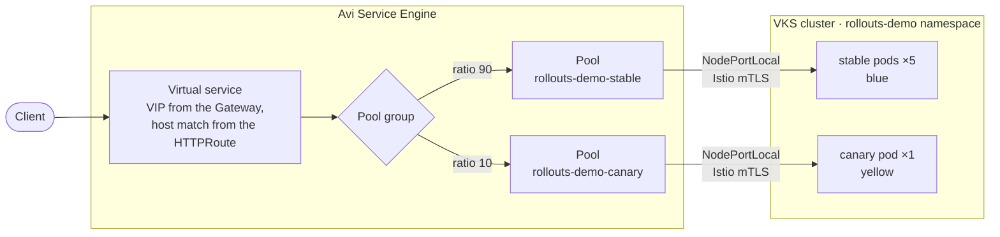
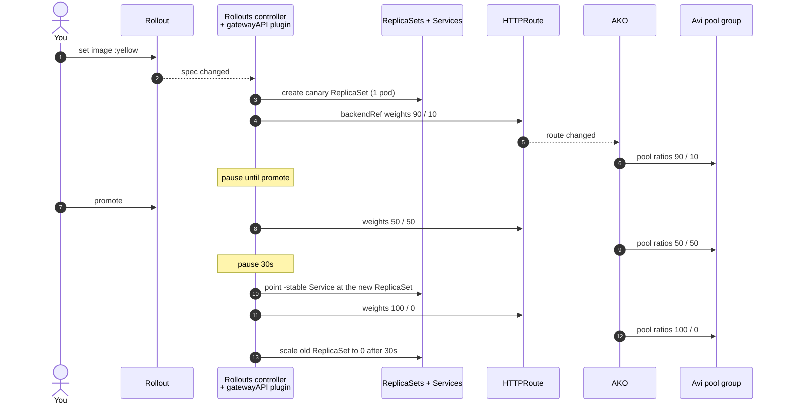

# Argo Rollouts canary with Gateway API on VKS + Avi

A canary demo with [Argo Rollouts](https://argoproj.github.io/rollouts/) on a
vSphere Kubernetes Service (VKS) cluster that uses the Avi Kubernetes
Operator (AKO) as its Gateway API implementation. The
[Gateway API plugin](https://github.com/argoproj-labs/rollouts-plugin-trafficrouter-gatewayapi)
shifts traffic by changing HTTPRoute weights, and Avi follows them exactly.

The app is [`argoproj/rollouts-demo`](https://github.com/argoproj/rollouts-demo).
It answers with its image tag's color, so a canary shows up as a mix of
colors in its UI.

Built and tested on:

- VKS cluster, Kubernetes v1.35, PodSecurity `restricted` by default
- AKO with Gateway API (`avi-lb` GatewayClass), `serviceType: NodePortLocal`
  and `istioEnabled: "true"`
- Argo Rollouts v1.10.1, Gateway API plugin v0.17.0

## How it works

A request goes through one Avi virtual service, and the pool group splits it
by ratio between the stable and canary pools:



A canary step changes those ratios through the HTTPRoute:



1. Both Services select `app: rollouts-demo`. The Rollouts controller adds
   `rollouts-pod-template-hash` to each selector, so `-stable` sees only the
   stable pods and `-canary` sees only the canary pods.
2. At each `setWeight` step, the controller calls the Gateway API plugin,
   which rewrites the two `backendRefs` weights on the HTTPRoute: 90/10,
   then 50/50, then 100/0. The plugin keeps no state of its own: the
   controller records the desired and verified weights in the Rollout's
   `status.canary.weights`, and re-applies them on every resync.
3. AKO turns the two backends into two Avi pools in one pool group, and sets
   each pool's `ratio` to the backend's weight. Avi splits requests by ratio,
   so traffic share does not depend on pod count.

At the 10% step, stable keeps its 5 pods and the canary runs 1 pod. 400
parallel requests split `360 / 40`.

The canary steps in `manifests/rollout.yaml`:

```yaml
steps:
- setWeight: 10
- pause: {}               # waits for a manual promote
- setWeight: 50
- pause: {duration: 30s}
- setWeight: 100
```

### What it looks like in Avi

AKO creates these objects in the Avi tenant set by `tenantName` in its
`avi-k8s-config` ConfigMap:

```
Parent VS   ako-gw-<cluster>--rollouts-demo-rollouts-demo-EVH   owns the VIP
 └─ Child VS   ako-gw-<cluster>--<hash>                          host + path match
     └─ Pool group                                               one per HTTPRoute rule
         ├─ pool  ratio 90   backend rollouts-demo-stable
         └─ pool  ratio 10   backend rollouts-demo-canary
```

| Kubernetes | Avi |
|---|---|
| Gateway | Parent virtual service (EVH) and VsVip |
| HTTPRoute host and path | Child virtual service |
| HTTPRoute rule | Pool group |
| `backendRef` and `weight` | Pool and its `ratio` in the pool group |
| Pods behind the Service | Pool servers, as `nodeIP:port` from Antrea NodePortLocal |

Pool names are hashes. Each pool's markers (`BackendName`,
`HTTPRouteName`) say which Service it came from.

To print the chain at any step (read-only API calls):

```sh
AVI_HOST=avi.example.com AVI_TENANT=<tenant> AVI_PASSWORD=... ./scripts/avi-show.sh
#   ratio 10  rollouts-demo-canary  LB_ALGORITHM_LEAST_CONNECTIONS  172.30.0.4:61029
#   ratio 90  rollouts-demo-stable  LB_ALGORITHM_LEAST_CONNECTIONS  172.30.0.3:61326 ...
```

`AVI_USER` defaults to `admin`. In the Avi UI, open the parent virtual
service, then its child, then the pool group.

## Repo layout

| Path | What |
|---|---|
| `controller/` | Controller config that loads the Gateway API plugin, and the RBAC it needs |
| `manifests/` | Namespace, Rollout, stable/canary Services, Gateway and HTTPRoute |
| `dashboard/` | Argo Rollouts dashboard, patched for PodSecurity and Istio, behind a Gateway |
| `local.example/` | Kustomize overlays that set your hostnames. Copy to `local/` |
| `scripts/avi-show.sh` | Prints the Avi objects and pool ratios for the HTTPRoute |

`manifests/` and `dashboard/` use `example.com` hostnames. Set yours in an
overlay, so the base stays generic:

```sh
cp -r local.example local      # local/ is gitignored
# edit the hostnames in local/app and local/dashboard
```

A hostname must be in a DNS sub-domain that your Avi DNS profile serves.
`local.example/app` also shows how to add namespace labels, for clusters
with a namespace label policy.

## Setup

You need cluster-admin on the cluster, and `kubectl`.

### 1. Install the Argo Rollouts controller

```sh
kubectl create namespace argo-rollouts
kubectl apply --server-side --force-conflicts -n argo-rollouts \
  -f https://github.com/argoproj/argo-rollouts/releases/download/v1.10.1/install.yaml
```

Use `--server-side`. A client-side apply fails on two CRDs with
`metadata.annotations: Too long: may not be more than 262144 bytes`.

### 2. Load the Gateway API plugin

```sh
kubectl apply --server-side --force-conflicts -k controller/
kubectl -n argo-rollouts rollout restart deploy/argo-rollouts
kubectl -n argo-rollouts logs deploy/argo-rollouts | grep -i plugin
```

The controller downloads the plugin from GitHub at startup and checks its
sha256, so the cluster needs egress to `github.com`.

The plugin runs as a child process of the controller and patches HTTPRoutes
with the controller's ServiceAccount, whose default ClusterRole cannot write
them. `controller/gatewayapi-rbac.yaml` adds that. It also allows
ConfigMaps, which the plugin needs only for header-based or mirror routes
(`setHeaderRoute`, `setMirrorRoute`), where it stores managed routes in
`argo-gatewayapi-configmap`. A weight-only canary like this one creates no
ConfigMap.

### 3. Install the kubectl plugin

```sh
curl -sLo ~/.local/bin/kubectl-argo-rollouts \
  https://github.com/argoproj/argo-rollouts/releases/download/v1.10.1/kubectl-argo-rollouts-linux-amd64
chmod +x ~/.local/bin/kubectl-argo-rollouts
```

### 4. Deploy the app

```sh
kubectl apply -k local/app
kubectl -n rollouts-demo get gateway rollouts-demo   # PROGRAMMED=True
curl http://<app-host>/color                         # "blue"
```

### 5. Deploy the dashboard (optional)

```sh
kubectl apply -k local/dashboard
```

Open `http://<dashboard-host>/rollouts/` and pick the `rollouts-demo`
namespace.

**The dashboard has no authentication.** Anyone who can reach it can
promote, abort or change any Rollout on the cluster. Keep it on a lab
network, or run it locally instead:

```sh
kubectl argo rollouts dashboard -n rollouts-demo   # http://localhost:3100/rollouts/
```

## Run the demo

Open the app UI. Watch the Rollout in a terminal:

```sh
kubectl argo rollouts get rollout rollouts-demo -n rollouts-demo --watch
```

**Canary to yellow:**

```sh
kubectl argo rollouts set image rollouts-demo -n rollouts-demo \
  rollouts-demo=argoproj/rollouts-demo:yellow
```

The Rollout pauses at 10%. Check the weights on the HTTPRoute, and in Avi
with `scripts/avi-show.sh`:

```sh
kubectl -n rollouts-demo get httproute rollouts-demo \
  -o jsonpath='{range .spec.rules[0].backendRefs[*]}{.name}={.weight} {end}{"\n"}'
# rollouts-demo-stable=90 rollouts-demo-canary=10
```

The plugin writes the route with field manager `gatewayAPI`
(`kubectl get httproute rollouts-demo --show-managed-fields -o yaml`), and
the controller logs `[SetWeight] plugin "argoproj-labs/gatewayAPI"` and
`Desired weight (stepIdx: 1) 10 verified`.

Then promote. It goes to 50/50, waits 30s, then moves to 100%:

```sh
kubectl argo rollouts promote rollouts-demo -n rollouts-demo
```

**Abort a bad release:**

```sh
kubectl argo rollouts set image rollouts-demo -n rollouts-demo \
  rollouts-demo=argoproj/rollouts-demo:red
kubectl argo rollouts abort rollouts-demo -n rollouts-demo
```

The canary weight drops to 0 at once. The Rollout shows `Degraded` until you
set the image back to the stable tag.

**Reset to blue:**

```sh
kubectl apply -k local/app
kubectl argo rollouts promote --full rollouts-demo -n rollouts-demo
```

Count the split from a terminal:

```sh
seq 200 | xargs -P 25 -I{} curl -s http://<app-host>/color \
  | tr '"' '\n' | grep -v '^$' | sort | uniq -c
```

Image tags: `blue`, `yellow`, `red`, `green`, `purple`, `orange`, and
`bad-*` variants that return errors.

## Notes for VKS + AKO

- **PodSecurity `restricted`.** The upstream manifests don't meet it. The
  Rollout and the dashboard set `runAsNonRoot`, a `seccompProfile`, and drop
  all capabilities.
- **Istio sidecar.** With AKO `istioEnabled`, Avi reaches pods over Istio
  mTLS. Without a sidecar the Gateway is programmed, but Avi answers `503`.
  The namespace has `istio-injection: enabled`. The dashboard pod uses the
  label `sidecar.istio.io/inject: "true"`.
- **Gateway hostnames.** Avi accepts a listener hostname only in a DNS
  sub-domain its DNS profile serves. Two Gateways cannot share one listener
  hostname.

## Tear down

```sh
kubectl delete -k local/dashboard
kubectl delete -k local/app
kubectl delete -k controller/
kubectl delete -n argo-rollouts \
  -f https://github.com/argoproj/argo-rollouts/releases/download/v1.10.1/install.yaml
kubectl delete namespace argo-rollouts
```

## License

Apache-2.0. See [LICENSE](LICENSE).
