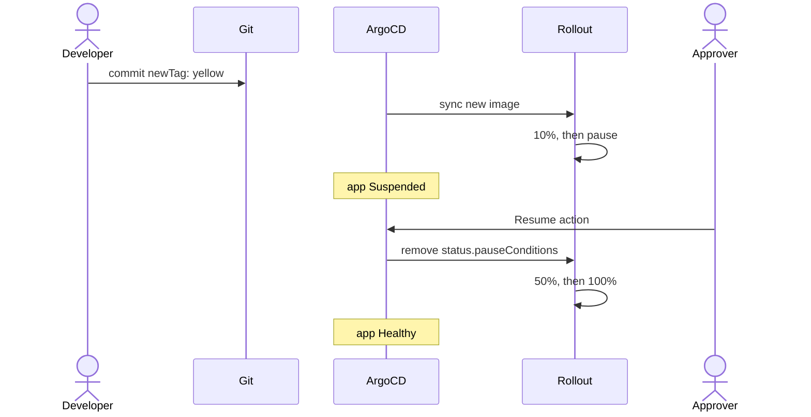

# Promotion options with ArgoCD

Ways to move a canary past its gate when the app is deployed by ArgoCD.
Option 1 is set up and tested in this repo (README "GitOps with a manual
gate"). The others are sketches: their YAML has not been run on the demo
cluster.

| | Option | Who promotes | Where the approval lives | Status here |
|---|---|---|---|---|
| 1 | ArgoCD **Resume** action | A person, in the ArgoCD UI or CLI | ArgoCD event + server log | Tested |
| 2 | Approval as a pull request | A person, by merging a PR | Git history | Sketch |
| 3 | Automated analysis | Nobody: metrics decide | AnalysisRun results | Sketch |
| 4 | Kargo | A person or policy, per environment | Kargo + git | Pointer only |

In all four, the release starts the same way: a commit changes `newTag` in
`manifests/kustomization.yaml`, and ArgoCD syncs it.

## How ArgoCD and Argo Rollouts fit together

Some background first, because the options only differ in how the pause gets
cleared.

### A pause lives in status, not spec

When the Rollout reaches `pause: {}`, the Rollouts controller writes the
pause into the Rollout's **status**:

```yaml
status:
  phase: Paused
  currentStepIndex: 1
  controllerPause: true
  pauseConditions:
  - reason: CanaryPauseStep
    startTime: "2026-10-15T21:52:37Z"
```

Promoting means removing `status.pauseConditions`. The controller then sees
no pause and moves to the next step.

ArgoCD syncs **spec** from git and does not manage status. So:

- Pausing and resuming never make the app `OutOfSync`.
- No commit can say "go past step 1" directly. That is why options 2-4 need
  some other way to clear or skip the pause.

### "Suspended" is ArgoCD's health check

ArgoCD has a built-in health check for the `argoproj.io/Rollout` kind. It
reads the Rollout status:

| Rollout status | ArgoCD health |
|---|---|
| Pause condition present | Suspended |
| Steps running | Progressing |
| All steps done, pods ready | Healthy |
| Aborted | Degraded |

An app's health is the worst health of its resources. So a paused Rollout
makes the whole app **Suspended**, and it stays **Synced**.

### Fields Argo Rollouts changes at runtime

Argo Rollouts edits two kinds of objects that ArgoCD also manages. The
Application needs `ignoreDifferences` for both, plus the sync option
`RespectIgnoreDifferences=true`. Without that option, the sync still writes
the fields even though the diff ignores them.

| Field | Changed by | Without the ignore |
|---|---|---|
| HTTPRoute `backendRefs[].weight` | Gateway API plugin, at each step | `selfHeal` sets the weights back to 100/0 in the middle of a canary |
| Service `spec.selector["rollouts-pod-template-hash"]` | Rollouts controller | The app stays `OutOfSync` |

See `argocd/application.yaml`.

## Option 1: ArgoCD Resume action

Keep `pause: {}` in the steps. A person clears the pause with one of
ArgoCD's built-in resource actions for Rollouts.



**Promote:** in the UI, open the app, click the Rollout, then **⋮ >
Resume**. Or with the CLI:

```sh
argocd app actions run rollouts-demo resume \
  --kind Rollout --resource-name rollouts-demo --group argoproj.io
```

**Reject:** run the `abort` action the same way, then revert the tag commit.

The other built-in actions are `abort`, `retry`, `restart` and
`promote-full`. `promote-full` skips all remaining steps.

`kubectl argo rollouts promote` makes the same change to status. The
difference is who is allowed to do it, and what gets recorded.

### Who can promote

ArgoCD RBAC controls who may run each action. For example, to let only an
approver group resume Rollouts in the `tenant-1` project:

```csv
p, role:rollout-approver, applications, get, tenant-1/*, allow
p, role:rollout-approver, applications, action/argoproj.io/Rollout/resume, tenant-1/*, allow
g, <idp-group-of-approvers>, role:rollout-approver
```

This goes in `argocd-rbac-cm` (`policy.csv`). On a managed ArgoCD, such as
the VCF ArgoCD service, check how the service lets you set RBAC before you
edit that ConfigMap. The service may overwrite it.

### Who promoted: the audit trail

| Where | Shows the person? | Notes |
|---|---|---|
| Kubernetes Event on the Application, reason `ResourceActionRan` | Yes | Message names the user, the action and the resource |
| argocd-server logs | Yes | The API call, with the user |
| Rollout `managedFields`, cluster audit log | No | Only ArgoCD's identity |
| Rollout events (`RolloutResumed`, `TrafficWeightUpdated`) | No | What happened and when |

Read the action events:

```sh
kubectl -n <argocd-namespace> get events \
  --field-selector involvedObject.name=rollouts-demo,reason=ResourceActionRan
```

Two things decide whether this audit trail is any use:

- **Personal logins.** If everyone uses the local `admin` account, every
  event says `admin`. Use SSO, and keep `admin` for emergencies.
- **Retention.** Kubernetes keeps events for a short time, often one hour.
  Export them, or the argocd-server logs, to a log system.

## Option 2: approval as a pull request

The promote becomes a reviewed, merged PR, so the approval sits in git
history with the approver's name on it.

Replace `pause: {}` with an `analysis` step that waits until git says the
canary image is approved. The approval is a ConfigMap synced by ArgoCD.

```yaml
# manifests/approval.yaml: set approvedImage to the canary image to promote
apiVersion: v1
kind: ConfigMap
metadata:
  name: rollouts-demo-approval
data:
  approvedImage: ""
```

```yaml
# manifests/rollout.yaml
steps:
- setWeight: 10
- analysis:                      # replaces pause: {}
    templates:
    - templateName: wait-for-approval
    args:
    - name: image
      valueFrom:
        fieldRef:
          fieldPath: spec.template.spec.containers[0].image
- setWeight: 50
- pause: {duration: 30s}
- setWeight: 100
```

```yaml
apiVersion: argoproj.io/v1alpha1
kind: AnalysisTemplate
metadata:
  name: wait-for-approval
spec:
  args:
  - name: image
  metrics:
  - name: approved
    provider:
      job:
        spec:
          backoffLimit: 0
          activeDeadlineSeconds: 86400       # no approval in a day: the step fails and the canary aborts
          template:
            metadata:
              labels:
                sidecar.istio.io/inject: "false"   # a sidecar would keep the Job pod running
            spec:
              serviceAccountName: approval-reader  # needs get on configmaps in this namespace
              restartPolicy: Never
              securityContext:
                runAsNonRoot: true
                seccompProfile: {type: RuntimeDefault}
              containers:
              - name: wait
                image: bitnami/kubectl:1.35
                securityContext:
                  allowPrivilegeEscalation: false
                  capabilities: {drop: ["ALL"]}
                command: ["sh", "-c"]
                args:
                - |
                  until [ "$(kubectl get cm rollouts-demo-approval -o jsonpath='{.data.approvedImage}')" = "{{args.image}}" ]; do
                    sleep 15
                  done
```

Flow:

1. PR 1 sets `newTag: yellow`. ArgoCD syncs it, the canary goes to 10%, and
   the analysis Job starts waiting.
2. Review the canary.
3. PR 2 sets `approvedImage: argoproj/rollouts-demo:yellow`. ArgoCD syncs
   the ConfigMap, the Job exits 0, and the Rollout continues.
4. To reject, revert PR 1.

Branch protection then applies to the promote too: required reviewers,
CODEOWNERS for `approval.yaml`, and so on.

Check before you use it:

- Whether `fieldRef` resolves `spec.template.spec.containers[0].image` on
  your Argo Rollouts version. If not, key the approval on the pod-template
  hash (`podTemplateHashValue: Latest`).
- The Job runs in the app namespace, so it must pass that namespace's
  PodSecurity level, and it must stay out of the mesh.

## Option 3: automated analysis

No person in the loop. Timed pauses give the canary time, and an analysis
checks a metric the whole time. A bad canary aborts on its own, and a good
one promotes on its own.

```yaml
strategy:
  canary:
    analysis:                    # runs in the background from step 1
      templates:
      - templateName: success-rate
      startingStep: 1
      args:
      - name: canary-hash
        valueFrom:
          podTemplateHashValue: Latest
    steps:
    - setWeight: 10
    - pause: {duration: 2m}
    - setWeight: 50
    - pause: {duration: 2m}
    - setWeight: 100
```

```yaml
apiVersion: argoproj.io/v1alpha1
kind: AnalysisTemplate
metadata:
  name: success-rate
spec:
  args:
  - name: canary-hash
  metrics:
  - name: success-rate
    interval: 30s
    failureLimit: 2
    successCondition: result[0] >= 0.95
    provider:
      prometheus:
        address: http://<prometheus>.<namespace>.svc:9090
        query: |
          sum(rate(istio_requests_total{destination_workload_namespace="rollouts-demo",
                pod_template_hash="{{args.canary-hash}}", response_code!~"5.."}[1m]))
          /
          sum(rate(istio_requests_total{destination_workload_namespace="rollouts-demo",
                pod_template_hash="{{args.canary-hash}}"}[1m]))
```

To show it: release a `bad-*` image tag, for example `bad-red`. It returns
errors, the success rate drops, and the Rollout aborts with the canary
weight back at 0.

You can combine this with option 1 or 2: analysis catches obvious failures,
and a person still makes the final call at a pause.

Check before you use it:

- Prometheus must scrape the Istio sidecars, and you need its address.
- Which label identifies the canary pods in the metrics depends on your
  scrape config. `pod_template_hash` is an assumption: you may need
  `destination_workload` or `destination_canonical_revision` instead.

## Option 4: Kargo

[Kargo](https://kargo.io) promotes a release between environments, such as
dev to staging to prod, with approvals and git commits for each stage. Argo
Rollouts still runs the canary inside each cluster. Kargo makes sense when
the question is "may this version go to the next environment", rather than
"may this canary go from 10% to 50%".

## Which one

- **Live demo:** option 1. The Resume click in ArgoCD shows the gate well.
- **Every change, including the promote, must be a reviewed PR:** option 2.
- **You trust your metrics:** option 3, alone or in front of option 1.
- **Several environments:** option 4, with one of the others inside each
  cluster.
